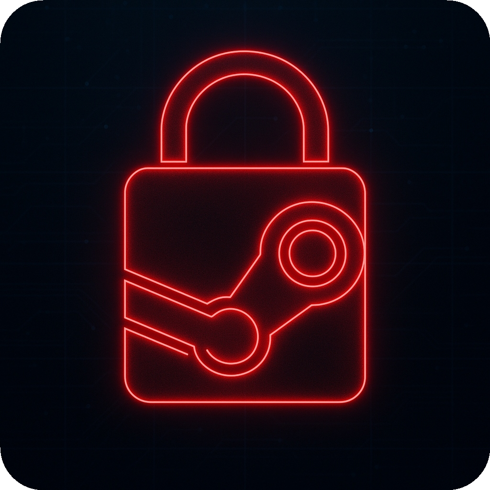

# SteamUnlocker

  

  [Releases](https://github.com/SteamUnlocker/SteamUnlocker/releases/latest) · [Code source](https://github.com/SteamUnlocker/SteamUnlocker)

  Client desktop Windows pour gérer vos configurations Steam et scripts `.lua`, écrit en **Rust** (**Tauri v2**, **React** & **TypeScript**) avec un **installateur autonome** (`eframe` / `egui`).

  **SteamUnlocker** gère la bibliothèque de scripts `config\stplug-in` (recherche instantanée par nom de jeu ou AppID, activation/désactivation `.lua` ↔ `.lua.disabled`, éditeur intégré, glisser-déposer `.lua` / `.st` / `.manifest`), l'installation et le réglage de **BetterSteamTools** et **CloudRedirect** via l'onglet **Mode**, ainsi que **5 thèmes** visuels dont le thème **Classic**.

  Entièrement en français, 100 % local, sans Discord ni téléchargement de jeux, avec **mises à jour automatiques** intégrées au démarrage via GitHub Releases.

 

## Statistiques

  
  
  

 

<a href="https://www.star-history.com/#SteamUnlocker/SteamUnlocker&Date">
  <picture>
    <source media="(prefers-color-scheme: dark)" srcset="https://api.star-history.com/svg?repos=SteamUnlocker/SteamUnlocker&type=Date&theme=dark" />
    <source media="(prefers-color-scheme: light)" srcset="https://api.star-history.com/svg?repos=SteamUnlocker/SteamUnlocker&type=Date" />
    
  </picture>
</a>

## Prérequis

- **Windows 10 / 11** (64 bits)
- **Microsoft Edge WebView2 Runtime** (déjà préinstallé sur Windows 10/11)
- Pour compiler depuis les sources : **Node.js 20+**, **Rust** (`x86_64-pc-windows-gnu`) et **MinGW64**

## Installation

Téléchargez la dernière version depuis l'onglet [Releases](https://github.com/SteamUnlocker/SteamUnlocker/releases/latest) :

- **`SteamUnlocker-Installer.exe`** *(recommandé)* : installateur autonome en un seul fichier (déploie l'application et `WebView2Loader.dll`, crée les raccourcis Bureau / Menu Démarrer et enregistre la désinstallation dans Windows).
- **`SteamUnlocker-Portable.zip`** : archive portable contenant `SteamUnlocker.exe` et `WebView2Loader.dll`.

Les mises à jour suivantes sont détectées, téléchargées et installées automatiquement au lancement (option configurable dans **Paramètres**).

## Crédits & projets associés

- [BetterSteamTools](https://github.com/madoiscool/BetterSteamTools) : chargement des scripts Lua dans Steam, installable et géré depuis l'onglet **Mode**
- [CloudRedirect](https://github.com/madoiscool/CloudRedirect) : redirection locale des sauvegardes Steam Cloud, activable et configurable (`opensteamtool.toml`) depuis l'onglet **Mode**
- [Tauri](https://tauri.app/) & [egui / eframe](https://github.com/emilk/egui) : frameworks Rust utilisés pour l'interface et l'installateur autonome

## Licence

MIT. Voir [LICENSE](LICENSE).
